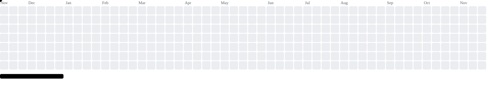

## 👨‍💻 About Me

> 👋 你好，我是 **CiZai**，一个普普通通的程序员，目前就职于 **金山办公 (WPS)**。热爱 **Coding** 与 **AI**，写代码之余喜欢玩 **Minecraft** ⛏️。

 

## 📊 GitHub Stats

  
  &nbsp;
  

 

## 🕹️ Contribution Arcade

<picture>
  <source media="(prefers-color-scheme: dark)" srcset="https://raw.githubusercontent.com/Ciao1019/Ciao1019/output/breakout-contribution-graph-dark.svg" />
  <source media="(prefers-color-scheme: light)" srcset="https://raw.githubusercontent.com/Ciao1019/Ciao1019/output/breakout-contribution-graph.svg" />
  
</picture>

